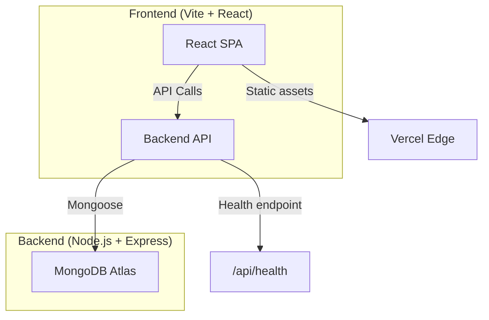

<div align="center">

# 🚀 SmartSlot

### Smart Scheduling. Seamless Booking.

A full-stack appointment and resource booking platform designed to make scheduling simple, efficient, and reliable.

<p>
  
  
</p>

<p>
  
  
  
  
</p>

<p>
  
  
  
  
</p>

**[🌐 Live Demo](https://smart-slot-nnmy1urwz-kavin-079c.vercel.app)** · **[📦 GitHub Repository](https://github.com/Kavin-666/SmartSlot)**

</div>

---

## 📌 About the Project

**SmartSlot** is a full-stack booking application that helps users discover available resources, reserve time slots, and manage their bookings through a centralized interface.

The project focuses on solving common scheduling problems, including double bookings, unavailable time slots, and managing users waiting for a reservation.

It combines a responsive frontend with a backend API and database to provide a structured booking experience.

> **Note:** Verify that the live demo URL is the correct production deployment before submission.

---

## ✨ Features

### 📅 Smart Booking System
- Browse available resources and time slots.
- Create and manage bookings.
- Prevent conflicting reservations through backend validation.
- Track booking details and status.

### ⏳ Waitlist Management
- Automatic promotion from wait‑list when a slot becomes free.
- FIFO ordering ensures fair allocation.

### 🔐 Role‑Based Authentication
- Secure JWT‑based login.
- Different dashboards for owners, clients, and administrators.

### 📱 Responsive UI
- Built with React 18, Vite, Tailwind CSS, and Framer Motion.
- Mobile‑first design with dark‑mode support.

---

## 🏗️ Architecture Overview


- **Frontend** makes HTTP requests to the backend. In production the base URL is supplied via the `VITE_API_BASE_URL` environment variable.
- **Backend** runs on Render, reads `MONGODB_URI`, `JWT_SECRET`, and `FRONTEND_ORIGIN` from its environment.
- **MongoDB Atlas** stores all data; the connection string is never committed to source control.

---

## 🛠️ Tech Stack
| Layer      | Technology                                           |
|------------|------------------------------------------------------|
| **Backend**| Node.js 24, Express 4, Mongoose 8, JWT, CORS, Helmet |
| **Frontend**| React 18, Vite, Tailwind CSS, Framer Motion, Lucide‑React |
| **Database**| MongoDB Atlas (managed)                             |
| **Testing**| Jest 29, Supertest                                   |
| **Deployment**| Render (backend), Vercel (frontend)                |

---

## 💻 Local Development
```bash
# Clone the repo (already done)
# Install root dependencies (optional) and workspace deps
cd smartslot
# Backend
cd backend && npm install && cp .env.example .env   # edit .env with your local MongoDB URI
npm run dev   # starts the API on PORT 5000

# Frontend
cd ../frontend && npm install && cp .env.example .env   # set VITE_API_BASE_URL to http://localhost:5000/api/v1
npm run dev   # starts Vite dev server on http://localhost:5173
```

Run the test suite:
```bash
cd backend && npm test
```
All tests should pass.

---

## 🚀 Production Deployment
### Backend (Render)
1. **Create a Web Service**
   - **Root Directory:** `backend`
   - **Build Command:** `npm install`
   - **Start Command:** `npm start`
2. **Add Environment Variables** (Settings → Environment):
   - `MONGODB_URI` – the Atlas connection string you created.
   - `JWT_SECRET` – a strong random string (`openssl rand -hex 32`).
   - `FRONTEND_ORIGIN` – the final Vercel URL (e.g., `https://smartslot-frontend.vercel.app`).
3. Deploy – Render will expose the service on a generated domain. Verify the health endpoint (`/api/health`).

### Frontend (Vercel)
1. **Import the GitHub repo** (`Kavin-666/SmartSlot`).
2. **Root Directory:** `frontend`
3. **Build Command:** `npm install && npm run build`
4. **Environment Variable:** `VITE_API_BASE_URL` → the Render backend URL (`https://<backend>.onrender.com/api/v1`).
5. Deploy – Vercel provides a live HTTPS URL.

After the frontend URL is known, **update `FRONTEND_ORIGIN`** in Render and redeploy the backend to enable CORS.

---

## ⚙️ Environment Variables
### Backend (`backend/.env.example`)
```dotenv
MONGODB_URI=mongodb://localhost:27017/smartslot
PORT=5000
JWT_SECRET=your_jwt_secret_here
FRONTEND_ORIGIN=http://localhost:5173
```
Replace the placeholders with the real values in your production environment (Render). Do **not** commit the real `.env` file.

### Frontend (`frontend/.env.example`)
```dotenv
VITE_API_BASE_URL=/api/v1   # relative for local dev, override in Vercel with full backend URL
```

---

## 📄 License
MIT © 2026 Kavin

---

*Demo Video: [SmartSlot Overview](https://drive.google.com/file/d/1k2mPCw6ZraMdU9_SWILVvTw2EAYiJv7h/view?usp=sharing)*

*This README reflects the current state of the project. Update URLs if deployments change.*
